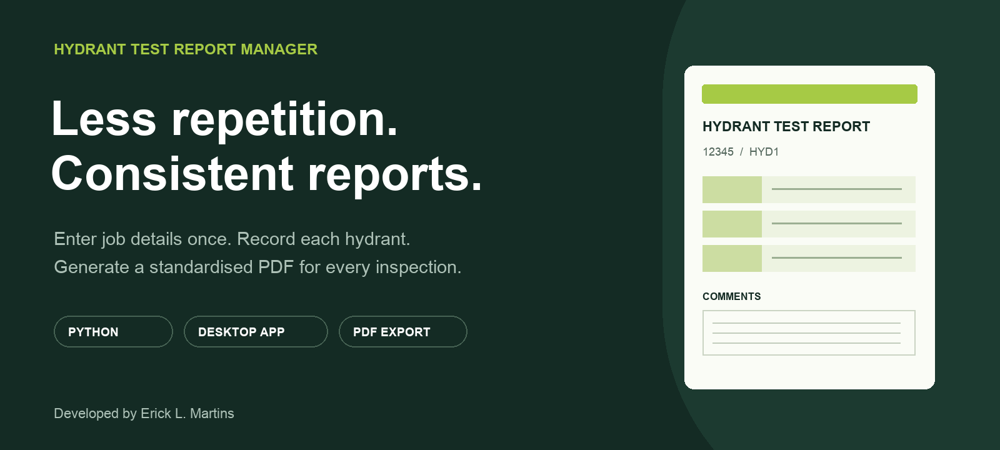
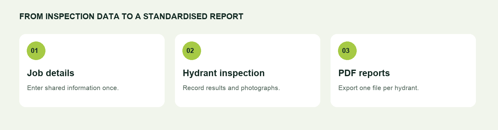
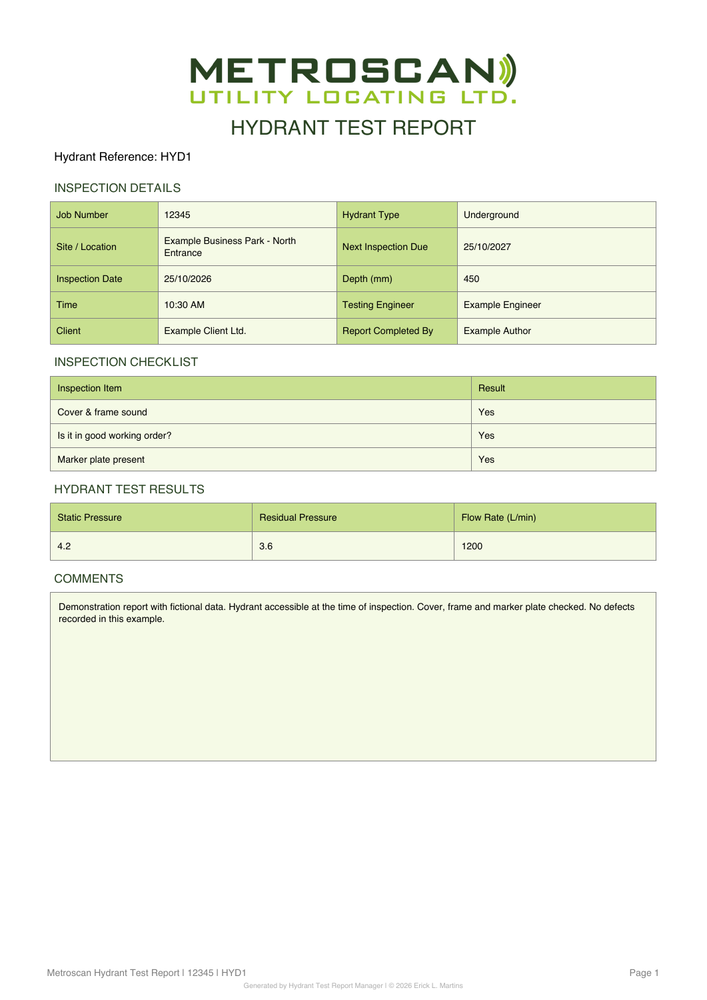

<p align="center">
  
</p>

<h1 align="center">Hydrant Test Report Manager</h1>

**Prepare hydrant inspection reports faster, with a consistent format from one job to the next.**

Hydrant Test Report Manager was created to speed up report preparation and standardise how inspection information is presented. Enter the shared job details once, record each hydrant separately, and generate individual PDF reports or a single file for the whole job.

Built for a Windows desktop workflow using Python, Tkinter and ReportLab.

## Why this application exists

Preparing separate reports often means repeating job details and formatting the same information multiple times. This application brings that process into one place: a shared job form, individual hydrant records and a consistent PDF layout.

The aim is straightforward: **less repetitive work, clearer organisation and standardised reports.**

## A simple workflow



1. **Enter the job details.** Add the job number, site, client, inspection dates and engineer information.
2. **Record each hydrant.** Enter its reference, type, depth, pressure readings and flow rate. Complete the checklist and add comments and photographs.
3. **Generate the reports.** Export individual PDFs or combine all hydrants into one file, with a consistent layout and identifiable filenames.

## Features

| Feature | What it does |
| --- | --- |
| Shared job details | Reuses the same job information across all hydrants in that job. |
| Multiple hydrants | Keeps individual inspection records in one working session. |
| Inspection results | Records static pressure, residual pressure and flow rate. |
| Checklist | Records cover and frame condition, working order and marker plate presence. |
| Comments | Provides a dedicated space for inspection notes and comments. |
| Photographic evidence | Includes two standard photographs and one horizontal photograph per hydrant. |
| Combined PDF | Exports all hydrants in the current job into one file, in list order. |
| Consistent PDF output | Uses the same report layout, branding and footer across reports. |
| Identifiable filenames | Saves reports using the job number and hydrant reference, such as `12345_HYD1.pdf`. |

## Report preview

The image below was generated by the application using fictional demonstration data. It shows the first page; the photographs are placed on the following page.



*Demonstration values are illustrative and do not define inspection acceptance criteria.*

## Create a report

1. Fill in **Job Details**, including the job number. Use `DD/MM/YYYY` for dates.
2. Complete the selected hydrant's details.
3. Review every checklist answer, enter the test results and add any comments.
4. Use **Choose Photos** for up to two standard photographs and **Choose Horizontal Photo** for the third image.
5. Select **+ Add Hydrant** to create another inspection in the same job.
6. Select **Generate All PDFs** for individual files, or **Generate Single PDF** to combine the current job into one file such as `12345_All_Hydrants.pdf`. Confirm the export.

## Where reports are saved

Reports are stored under the current user's home folder:

```text
Documents/
└── HydrantReports/
    └── PDFs/
        └── 12345/
            ├── 12345_HYD1.pdf
            ├── 12345_HYD2.pdf
            ├── 12345_HYD3.pdf
            └── 12345_All_Hydrants.pdf
```

Use **Open PDF Folder** to access the output folder.

## Getting started on Windows

### Run the executable

If you have received the packaged application:

1. Copy `HydrantTestApp.exe` to a folder on your Windows computer.
2. Double-click the file to open the application.
3. Enter your job details and start creating reports.

No Python installation is required to run the packaged executable.

### Run from source

Install Python 3.12 or later with Tkinter. Keep the application modules, `logo.png` and both `icon-hydrant-circular` files (`.png` and `.ico`) together in the project folder.

Open PowerShell in that folder and install the dependencies:

```powershell
py -m pip install -r requirements.txt
```

Start the application:

```powershell
py hydrant_app.py
```

## Build the Windows executable

On Windows, double-click `build_windows.bat`. The script creates a separate build environment, installs the required packages and generates:

```text
dist/HydrantTestApp.exe
```

The executable includes the logo and application icon. Python is required on the build computer; the resulting executable can be distributed to users without a Python installation. Build and test the Windows executable on Windows.

## Project structure

```text
HydrantTestApp/
├── hydrant_app.py       # Desktop interface and application entry point
├── app_data.py          # Form fields and inspection defaults
├── report_pdf.py        # PDF layout and comment sizing
├── file_utils.py        # Filenames, folder opening and safe PDF writes
├── logo.png
├── icon-hydrant-circular.png
├── icon-hydrant-circular.ico
├── build_windows.bat
├── requirements-build.txt
├── requirements.txt
├── tests/
│   └── test_app.py      # Automated tests
└── docs/images/         # README illustrations and report preview
```

Start the application with `py hydrant_app.py`. Keep the Python modules together when copying the source to another computer.

To run the automated tests:

```powershell
py -m unittest discover -s tests -v
```

## Built with

**Python** · **Tkinter / ttk** · **ReportLab** · **pypdf**

## Author

Developed by **Erick L. Martins**.

© 2026 Erick L. Martins. All rights reserved.
